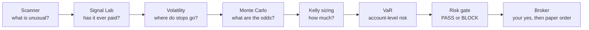

# The MIT Trader skill

**MIT OpenCourseWare's quant finance course, turned into 14 Claude skills.**

MIT's course 18.S096, *Topics in Mathematics with Applications in Finance*, is
free online: 26 lectures where MIT mathematicians teach the math and Morgan
Stanley practitioners show how it is used on a trading floor. Linear algebra,
probability, stochastic processes, regression, time series, GARCH volatility,
Value at Risk, portfolio theory, factor models, Kelly sizing, Ito calculus,
Black-Scholes, cointegration, Kalman filters, optimal execution.

This repo turns that course into skills an AI agent can use. Plug it into
Claude (Claude Fable 5.2, Opus, Sonnet, any model) and it can scan the market,
test whether a pattern has ever really paid, forecast volatility, simulate
10,000 futures of a trade, size it with Kelly, measure the whole account's
Value at Risk, check every order against your limits, and send it to your
broker, paper trading by default and **never without your yes**.

Free, no signup, no API key. Plain Python with nothing to install, on free
Yahoo Finance data. US stocks, ETFs and crypto.

> Not affiliated with, endorsed by or sponsored by MIT. This is an independent
> project built on the course's public OpenCourseWare materials.

## What makes it different

Most "AI trading bots" look for patterns and trade them. This one does what
the course teaches: it asks whether the pattern is real first, and it is not
shy about saying no.

On Friday November 20, 2026, after a month-long selloff, the scanner found 32
setups in 42 stocks. The regression lab tested every one against five years
of history. Proven edges: **zero**. The Monte Carlo then showed why buying
Nvidia's 41% crash was a coin flip, and Kelly sized it at nothing. That is
the math working.

## Install

Paste this into Claude:

```
https://github.com/roan-maverick/MIT-trader-skill

install skill
```

Or as a plugin, in Claude Code:

```
/plugin marketplace add roan-maverick/MIT-trader-skill
/plugin install mit-trader-skill@mit-trader-skill
```

Installed as a plugin, the skills are namespaced (`/mit-trader-skill:mit-scanner`
and so on). To get plain `/mit-scanner`, copy the folders instead:

```bash
git clone https://github.com/roan-maverick/MIT-trader-skill.git
cp -r MIT-trader-skill/mit-* ~/.claude/skills/
```

No Claude Code at all? Paste any single `SKILL.md` into a chat and it works as
a mode. You lose the Python tools, but Claude still knows the method.

The tools need Python 3.8 or newer. Nothing to `pip install`.

## The fourteen

| command | job | the MIT math inside |
| --- | --- | --- |
| `/mit-scanner` | Scans stocks, ETFs and coins for statistically unusual prices | z-scores (L3), trend regression (L6), OU half-life (L8, L21) |
| `/mit-regression` | The Signal Lab: is this edge real or luck? EDGE, WEAK or NONE | predictive regression, Newey-West, event study, out-of-sample, Bonferroni (L6) |
| `/mit-volatility` | Forecasts volatility and sets stops and targets outside the noise | GARCH(1,1) by maximum likelihood (L9) |
| `/mit-montecarlo` | Plays the trade forward 10,000 times and counts the odds | GARCH simulation, Brownian bridge, Ito, optional stopping (L5, L9, L17, L18) |
| `/mit-factors` | How much of a move is just the market; is there alpha? | CAPM, Kalman beta, factor models, PCA (L2, L12, L15) |
| `/mit-portfolio` | How much to buy, and how to split money long term | Kelly (L16, L25), Markowitz (L14), risk parity (L16), shrinkage (L10) |
| `/mit-var` | How much could the whole account lose on a bad day? | historical, parametric and Monte Carlo VaR, expected shortfall, Kupiec (L7) |
| `/mit-risk` | Checks every order against your limits: PASS or BLOCK | your rules, plus the VaR limit |
| `/mit-broker` | Sends approved orders to your broker, never without your yes | Alpaca, paper trading by default |
| `/mit-pairs` | Trades two assets that move together (stat arb) | cointegration, Engle-Granger, Kalman hedge ratio, OU (L8, L11, L12, L21) |
| `/mit-options` | Prices options and reads the market's probabilities | Black-Scholes (L19), Ito (L18), option-probability duality (L20, L25) |
| `/mit-execution` | Splits a big order so it does not move the price | calculus of variations, Almgren-Chriss (L22) |
| `/mit-autopilot` | Runs the whole pipeline on a schedule and writes a report | all of the above |
| `/mit-professor` | Explains any number, any lecture, in plain words | the 26 lectures as study notes |

## Your first 10 minutes (no coding needed)

You talk to Claude in plain English. Claude runs the tools.

1. **Install** (above).
2. **Set up a practice account.** Say: *"Set up my MIT trader config with a
   $10,000 paper budget and a $100 max loss per trade."* Claude copies
   `mit-portfolio/config.example.json` to `mit/config.json` and fills it in.
   Every limit lives in that one file.
3. **Run the whole thing.** Say: *"Run /mit-autopilot."* In about a minute you
   get a report: what is unusual in the market today, whether any of it has
   ever paid, the odds of each trade, how much Kelly would bet, and whether
   your risk rules allow it.
4. **Ask why.** Say: *"Explain the GARCH number like I'm 15"* or *"Why did Kelly
   say zero?"* /mit-professor answers from the course.
5. **Try one stock.** Say: *"Should I buy the dip in Tesla? Use the MIT skills."*

Nothing is ever bought until you connect a broker and type yes for one
specific order. Until then it is research.

## How it works, in plain English



Everything lands in a `mit/` folder in your project, and each skill reads what
the one before it wrote. You can run any skill on its own.

Think of it as a careful analyst who:

1. **Notices** things (a stock fell 2 standard deviations below normal),
2. **checks the record** (how often did that actually lead to profit, and could
   it be luck?),
3. **plans** the trade (stop far enough to survive normal noise),
4. **simulates** it (10,000 possible next weeks),
5. **sizes** it (Kelly: the bet that grows money fastest without blowing up,
   then cut in half, then capped by your limits),
6. **checks the whole account** (how bad could a bad day be?),
7. **checks your rules**, and
8. **asks you**.

## The worked example: "Should I buy Nvidia's crash?"

Real data. Friday November 20, 2026. Nvidia had fallen from about $212 to
$125.53 in a month, down 14% on the day itself. Everyone was asking whether to
buy the dip. Here is what the MIT math said. (The test suite reproduces every
number below, offline.)

1. **`/mit-scanner`** across 42 stocks, ETFs and Bitcoin: 32 setups. NVDA was
   a dip:
   `NVDA dip close 125.53  5d -22.9%  21d -40.8%  2.29 std below its 20-day mean (179.43)`.
   168 tests in all (42 symbols x 4 rules), which matters for the next step.

2. **`/mit-regression`** asked five years of NVDA history: every time it closed
   2 standard deviations below its 20-day mean, what happened over the next 5
   days? **26 times. It rose 1.76% on average (vs 0.65% for any 5 days) and won
   69% of the time.** Sounds great. But t = 0.79, and with 168 tests the bar
   for luck is 3.62. Verdict **NONE**: 26 events is far too few to tell a real
   edge from a lucky streak. Across all 32 setups that day: 0 EDGE, 7 WEAK, 25 NONE.

3. **`/mit-volatility`** fitted GARCH(1,1): tomorrow's volatility 100% a year,
   almost twice the long-run 56%. One standard deviation over 5 days: 13.7%.
   Plan: buy 125.53, **stop 109.43** (1 sigma down), **target 165.18** (2 sigma
   up), reward:risk 2.46.

4. **`/mit-montecarlo`** played the next 5 days 10,000 times (seed 18), with
   NVDA's own fat-tailed shocks: **target first 3.8%, stop first 28.5%, neither
   67.7%**. Expected result +0.015 R, inside the simulation's margin of error.
   History agreed: the same rule on the 26 real dips hit the target 2 times
   and the stop 5 times. Verdict: **close to a coin flip**.

5. **`/mit-factors`**: beta 1.93 to the S&P 500. A bet on NVDA was mostly a bet
   on the market, at twice the size. Alpha over the year: not distinguishable
   from zero.

6. **`/mit-portfolio`** with a $10,000 account: **Kelly says 0. No bet.** The
   odds do not pay for the risk.

That is the honest answer, and the point of the pack. If you insist anyway
(`--method fixed`, risk exactly your max loss):

7. 6 shares ($753.18). If the stop fills at 109.43, the loss is $96.60.
8. **`/mit-var`**: the account's 1-day 99% VaR becomes $58.85 (historical),
   0.59% of equity, inside the 5% limit. Kupiec backtest: 2 breaks in 250 days,
   2.5 expected. The model holds up.
9. **`/mit-risk`** on Monday at 10:00 New York: **PASS**, with a warning that the
   setup has no proven edge. 7 shares: BLOCK ($112.70 over the $100 max loss).
   At 9:40: BLOCK (no entries before 9:45). On Sunday: BLOCK (market closed).
10. **`/mit-broker`** shows the ticket in plain words: buy 6 NVDA, stop-loss
    109.43, take-profit 165.18, max loss $96.60, paper account. "sure" is not a
    yes. "yes to all" is not a yes. "yes buy 6 TSLA" is not a yes for this
    order. "yes, buy 6 NVDA" is. Then Claude's own Allow once / Deny card asks
    one more time.

## Build your own 24/7 trading system

"A bot that makes alpha while you sleep" is the dream. Here is what the
math lets you build honestly, in three levels. Do them in order, and stay on
paper trading until you have weeks of results.

### First, the truth about alpha (Lecture 5)

Alpha is return that is not explained by just holding the market. It is rare,
small, and it fades once others find it.

The course proves something every trader should know. If a price has no
predictable drift (a "martingale"), then **no stop-loss, no take-profit and no
exit rule can make the expected profit anything but zero**. That is Doob's
optional stopping theorem. Stops and targets change the shape of your results
(many small losses and a few big wins, or the reverse), never the average.
So the only source of profit is a real, measured edge. This pack therefore:

- simulates drift **only** from an edge /mit-regression measured, scaled down
  by how credible it is (t-statistic divided by the bar for luck),
- sizes with Kelly, which bets nothing when there is no edge, and
- caps everything with hard limits that you set.

What you get is a machine that finds edges if they exist, tells you plainly
when they do not, and keeps losses small either way. On most days the right
trade is no trade.

### Level 1: a research analyst on a schedule (no broker needed)

Ask Claude:

> *"Every weekday at 9:50 AM New York time, run /mit-autopilot and send me the
> report."*

Claude creates a scheduled task. Each morning you get the report (also saved
in `mit/report.md` and `mit/reports/`): today's setups, which have a proven
edge, the odds, the sizes, and which orders would pass your risk rules.

In Claude Code on your own computer, the same with cron:

```
50 9 * * 1-5  cd ~/trading && claude -p "/mit-autopilot run, then summarize mit/report.md"
```

### Level 2: connect a paper broker

1. Make a free [Alpaca](https://alpaca.markets) account and create **paper
   trading** keys.
2. Follow the setup in [`mit-broker/SKILL.md`](mit-broker/SKILL.md): add
   Alpaca's official MCP server to Claude Desktop (your keys go in a config
   file on your computer, **never in the chat**), and set the order tools to
   **Needs approval**.
3. Now when the report has a ticket that passed /mit-risk, say *"show me the
   tickets"*. You read the ticket, type yes for that one order, and click
   Allow once. The stop-loss and take-profit wait at the broker.

A scheduled run cannot place orders by itself, by design: nobody is there
to say yes. It prepares; you approve.

### Level 3: around the clock with crypto

Stocks trade 6.5 hours a day; crypto trades 24/7. Add Bitcoin and Ethereum to
your universe (`"BTC-USD", "ETH-USD"`, already in the default list) and add a
second scheduled task:

> *"Every 2 hours, run /mit-autopilot watch."*

It checks every open position against its stop, target and time limit. Alpaca
has no bracket orders for crypto, so for a coin past its stop it writes the
closing order, and you approve it like any other.

### Before you ever turn off paper trading

- Weeks of paper results, kept in `mit/state/broker.json`.
- At least one setup rated **EDGE**, still EDGE after more data.
- Limits you can afford to hit every day for a month.
- You understand every number in the report. Ask /mit-professor.

Going live means you change `"paper": false` yourself and put live keys in
your own config. The skills never do either for you.

## The course, lecture by lecture

| # | lecture | skill |
| --- | --- | --- |
| 1 | Introduction, financial terms and concepts | /mit-factors (alpha, beta) |
| 2 | Linear algebra | /mit-factors pca, /mit-var |
| 3 | Probability theory | /mit-scanner, /mit-regression |
| 4 | Matrix primer | /mit-var, /mit-portfolio |
| 5 | Stochastic processes I | /mit-montecarlo (the drift rule) |
| 6 | Regression analysis | /mit-regression, /mit-factors |
| 7 | Value at Risk models | /mit-var |
| 8 | Time series analysis I | /mit-scanner, /mit-pairs |
| 9 | Volatility modeling | /mit-volatility, /mit-montecarlo |
| 10 | Regularized pricing and risk models | /mit-portfolio, /mit-var |
| 11 | Time series analysis II | /mit-pairs |
| 12 | Time series analysis III | /mit-pairs, /mit-factors |
| 13 | Commodity models | /mit-professor |
| 14 | Portfolio theory | /mit-portfolio |
| 15 | Factor modeling | /mit-factors |
| 16 | Portfolio management | /mit-portfolio |
| 17 | Stochastic processes II | /mit-montecarlo |
| 18 | Ito calculus | /mit-montecarlo, /mit-options |
| 19 | Black-Scholes, risk-neutral valuation | /mit-options |
| 20 | Option price and probability duality | /mit-options |
| 21 | Stochastic differential equations | /mit-pairs, /mit-montecarlo |
| 22 | Calculus of variations in FX execution | /mit-execution |
| 23 | Quanto credit hedging | /mit-professor |
| 24 | HJM model for interest rates and credit | /mit-professor |
| 25 | Ross recovery theorem | /mit-options, /mit-portfolio |
| 26 | Counterparty credit risk | /mit-professor |

Study notes for each are in [`mit-professor/lectures/`](mit-professor/lectures).
The original course (videos, notes, problem sets) is free at
[ocw.mit.edu](https://ocw.mit.edu/courses/18-s096-topics-in-mathematics-with-applications-in-finance-fall-2013/).

## The tools

All standard-library Python. Run from your project folder; results go to `./mit/`.

```bash
python3 mit-scanner/scan.py run --write                               # setups across your universe
python3 mit-regression/signal.py candidates --write                   # EDGE / WEAK / NONE
python3 mit-volatility/vol.py plan NVDA --write                       # GARCH stop and target
python3 mit-montecarlo/montecarlo.py run --write                      # 10,000 futures + history
python3 mit-factors/factors.py beta NVDA                              # beta, alpha, Kalman beta
python3 mit-portfolio/portfolio.py size --write                       # Kelly -> mit/orders.json
python3 mit-portfolio/portfolio.py optimize --tickers SPY,TLT,GLD,QQQ --method riskparity
python3 mit-var/var.py run --include-orders --write                   # 1-day 99% VaR
python3 mit-risk/check.py                                             # PASS / BLOCK
python3 mit-broker/ticket.py show                                     # tickets, READY or not
python3 mit-pairs/pairs.py scan                                       # cointegrated pairs
python3 mit-options/options.py prob --spot 125.53 --level 150 --days 30 --vol 0.95
python3 mit-execution/execution.py plan NVDA --qty 50000 --urgency 1
python3 mit-autopilot/autopilot.py run                                # everything, one report
python3 mit-autopilot/autopilot.py watch                              # positions vs stops
```

Add `--data tests/fixtures/bars --asof 2026-11-20` to any data command to run
on the bundled real data, offline and repeatable.

```bash
python3 -m unittest discover -s tests -v
```

The tests run offline on real daily closes for 41 stocks and ETFs and Bitcoin
(November 2021 to November 20, 2026), and reproduce every number in the worked
example. The math is checked against textbook answers (Hull's Black-Scholes
example, t and chi-square tables, MacKinnon's critical values, the Almgren-Chriss
straight line at zero urgency) and against theorems (optional stopping: a
martingale with a stop and a target has zero expected value).

## Fine print

**Not financial advice.** This is software that reads public data and does
arithmetic. It does not know your situation and it cannot see the future.
Most people who trade actively lose money. You can lose money. Decide for
yourself, and talk to a licensed professional if you need advice.

**No trade goes through until you say yes.** Only `/mit-broker` can lead to an
order, and only after `/mit-risk` passes that exact order today, you type yes
for it in the chat, and you click Allow once on Claude's own card. Set your
broker's order tools to "Needs approval", never "Always allow". No options,
margin or short selling unless you turn them on.

**Paper first.** `"paper": true` is the default and Alpaca's MCP server
defaults to its paper account. Keys live in your own config file, never in
the chat.

**Models are simplifications.** GARCH, Monte Carlo, VaR and Kelly are built
from the past. The future can do things the past never did: an earnings
report, a CEO resignation, a crash. A stop is a plan, not a guarantee: across
a gap it can fill well past its price. VaR is not the worst case.

**The data is free and unofficial.** Yahoo Finance's chart endpoint is not an
official API: it can lag, change or rate-limit you. Daily bars, not ticks.
Check anything that matters against your broker. The test fixtures come from
public GitHub mirrors of Yahoo Finance daily closes and of Bitstamp's daily
Bitcoin prices.

**Taxes.** Short-term gains are taxed as ordinary income in many countries,
and frequent trading makes wash sales likely. Nothing here is tax advice.

**MIT.** Not affiliated with, endorsed by or sponsored by the Massachusetts
Institute of Technology. "MIT" in the name refers to the course the math
comes from. The study notes in `mit-professor/lectures/` are an independent
summary of MIT OpenCourseWare 18.S096 (Fall 2013), whose materials are
licensed CC BY-NC-SA 4.0; those notes carry the same license (see
[`mit-professor/LICENSE-lectures.md`](mit-professor/LICENSE-lectures.md)).
Lectures 4 and 22 have no published notes or video; their study notes and
/mit-execution follow the standard treatment of those topics.

## Files

```
mit-scanner/     SKILL.md, scan.py
mit-regression/  SKILL.md, signal.py
mit-volatility/  SKILL.md, vol.py
mit-montecarlo/  SKILL.md, montecarlo.py
mit-factors/     SKILL.md, factors.py
mit-portfolio/   SKILL.md, portfolio.py, config.example.json
mit-var/         SKILL.md, var.py
mit-risk/        SKILL.md, check.py
mit-broker/      SKILL.md, ticket.py, claude_desktop_config.example.json
mit-pairs/       SKILL.md, pairs.py
mit-options/     SKILL.md, options.py
mit-execution/   SKILL.md, execution.py
mit-autopilot/   SKILL.md, autopilot.py
mit-professor/   SKILL.md, lectures/L01.md ... L26.md
lib/mitlib.py    the shared math (every skill folder carries an identical copy)
tools/           sync_lib.py
tests/           unittest suite + real-data fixtures
```

Code: MIT License. Lecture study notes: CC BY-NC-SA 4.0.
