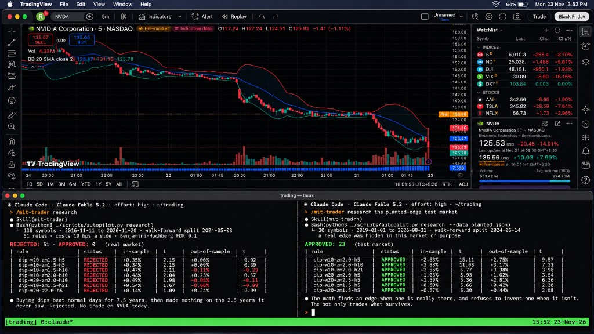
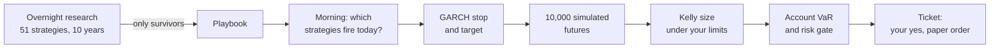

<!-- Reviewed for local use -->
# The MIT Trader skill

**I turned MIT's entire quant finance course into one Claude skill.**

MIT's course 18.S096, *Topics in Mathematics with Applications in Finance*,
is free on MIT OpenCourseWare: 26 lectures where MIT mathematicians teach the
math and Morgan Stanley practitioners show how a trading floor uses it.
Linear algebra, probability, stochastic processes, regression, time series,
GARCH volatility, Value at Risk, Markowitz, factor models, Kelly, risk
parity, Ito calculus, Black-Scholes, cointegration, Kalman filters, optimal
execution.

All of it is now one skill: `mit-trader`. Plug it into Claude (Claude Fable
5.2, Opus, Sonnet, any model) and:

1. **It researches the market overnight.** It tests 51 trading strategies
   built from the course on every stock, ETF and coin you follow, over up to
   10 years, with the statistics MIT teaches: walk-forward testing, clustered
   t-statistics, false-discovery control and real trading costs.
2. **It hands you a trading bot.** Every morning the bot hunts only for the
   strategies that survived, plans each trade with a GARCH stop, simulates it
   10,000 times, sizes it with Kelly, checks your whole account's Value at
   Risk and your limits, and puts the ticket in front of you.
3. **You say yes, or it does nothing.** Orders go to your broker on paper
   trading by default and **never without your yes**.

Free, no signup, no API key. Plain Python with nothing to install, on free
Yahoo Finance data. US stocks, ETFs and crypto.

> Not affiliated with, endorsed by or sponsored by MIT. An independent project
> built on the course's public OpenCourseWare materials.

## The part most trading bots leave out

A trading bot is only as good as the strategies it trades, and most
backtests lie: try enough rules on enough stocks and some will look
brilliant by luck. The course's statistics exist to catch exactly that, so
this skill uses all of them, and it tells you when nothing is real.

Here is the overnight research on real data, to Friday November 20, 2026:
138 US stocks and ETFs plus Bitcoin, 10 years, 51 strategies.

```
## Approved: 0
| rule              | status   | in-sample excess | t    | out-of-sample excess | t     |
| dip-w20-zm1.5-h5  | REJECTED | +0.35%           | 2.15 | +0.00%               | 0.02  |
| dip-w10-zm1.5-h5  | REJECTED | +0.34%           | 2.15 | +0.09%               | 0.39  |
| dip-w10-zm1.5-h10 | REJECTED | +0.47%           | 2.11 | -0.11%               | -0.29 |
```

Buying dips beat ordinary days by 0.35% a trade, after costs, for seven and
a half years. A normal backtest would have stopped there and sold you that
bot. Then the rule had to work on the last two and a half years, which it had
never seen, and it made **nothing**. So the bot stands down.

And when an edge is real, it finds it. On a test market with a genuine edge
planted in it, the same research approves the dip strategies (t of 15 in
sample, 9.6 out of sample) while rejecting every trend, breakout and
volatility rule, and the bot turns them into sized, risk-checked tickets.
Both runs are in the test suite.

That is the promise: **the exact math MIT teaches, finding real edges when
they exist, and refusing to invent them when they don't.**



*Nvidia on November 21, 2026, next to the overnight research. On ten years of real prices every rule is rejected, so the bot does not trade. On a test market with a real edge planted in it, the same math approves the dip rules and refuses the rest.*

## Install

Paste this into Claude:

```
https://github.com/roan-maverick/MIT-trader-skill

install skill
```

Or as a plugin, in Claude Code:

```
/plugin marketplace add roan-maverick/MIT-trader-skill
/plugin install mit-trader-skill@mit-trader-skill
```

Or copy the one folder:

```bash
git clone https://github.com/roan-maverick/MIT-trader-skill.git
cp -r MIT-trader-skill/mit-trader ~/.claude/skills/
```

The tools need Python 3.8 or newer. Nothing to `pip install`.

## Your first night (no coding needed)

You talk to Claude in plain English. The skill runs the tools.

1. **Set up a practice account.** *"Set up the MIT Trader with a $10,000 paper
   budget and a $100 max loss per trade."* Every limit lives in one file,
   `mit/config.json`.
2. **Start the research.** *"Research the market overnight with the MIT
   Trader and build me a trading bot."* It runs the strategy hunt and writes
   `mit/research.md`: every strategy tested, which survived, and why the others
   failed.
3. **Schedule it.** *"Run the research every night at 2 AM, and run the bot
   every weekday at 9:50 AM New York time. Send me the report."* Claude creates
   both scheduled tasks.
4. **Read the morning report.** It says which approved strategies fired, the
   odds, the size, the account's risk, and which tickets are ready. If nothing
   is approved or nothing fired, the bot stands down today.
5. **Ask anything.** *"Should I buy the dip in Tesla?"*, *"What is GARCH, like
   I'm 15?"*, *"Why did Kelly say zero?"*, *"Quiz me on lecture 9."*

Nothing is ever bought until you connect a broker and type yes for one
specific order.

## What's inside the one skill

```
mit-trader/
  SKILL.md               the brain: routes every request to the right math
  scripts/               15 plain-Python tools sharing one math library
  references/            a guide for every tool + 26 lecture study notes
  config.example.json    your budget and every limit
```

| ability | tool | the MIT math inside |
| --- | --- | --- |
| **Overnight strategy research** | `hunt.py` | event studies (L6), walk-forward, clustered t, Benjamini-Hochberg, costs |
| **The trading bot** | `autopilot.py` | everything below, in order, every morning |
| Market scanner | `scan.py` | z-scores (L3), trend regression (L6), OU half-life (L8, L21) |
| Signal lab: is this edge real? | `signal.py` | predictive regression, Newey-West, out-of-sample, Bonferroni (L6) |
| Volatility, stops and targets | `vol.py` | GARCH(1,1) by maximum likelihood (L9) |
| 10,000 futures of a trade | `montecarlo.py` | GARCH simulation, Brownian bridge, Ito, optional stopping (L5, L9, L17, L18) |
| Beta, alpha, hidden factors | `factors.py` | CAPM, Kalman beta, macro factors, PCA (L1, L2, L12, L15) |
| Position size and portfolios | `portfolio.py` | Kelly (L16, L25), Markowitz (L14), risk parity (L16), shrinkage (L10) |
| Whole-account risk | `var.py` | historical, parametric, Monte Carlo VaR, expected shortfall, Kupiec (L7) |
| Risk gate | `check.py` | your limits plus the VaR limit: PASS or BLOCK |
| Broker | `ticket.py` | Alpaca, paper by default, three gates before any order |
| Pairs trading | `pairs.py` | cointegration, Engle-Granger, Kalman hedge, OU (L11, L12, L21) |
| Options | `options.py` | Black-Scholes (L19), Ito (L18), option-probability duality (L20, L25) |
| Splitting big orders | `execution.py` | calculus of variations, Almgren-Chriss (L22) |
| The professor | 26 lecture notes | every lecture, explained in plain words |

## How the bot works, in plain English



Think of it as a careful quant who works the night shift:

1. **Researches** (overnight): tries every strategy in the book on years of
   data and keeps only what survives tests designed to catch luck.
2. **Hunts** (each morning): checks which surviving strategies fire today.
3. **Plans**: puts the stop beyond normal noise (volatility forecast).
4. **Simulates**: 10,000 possible next weeks, using the strategy's measured
   edge, never an imagined one.
5. **Sizes**: Kelly, the bet that grows money fastest without blowing up, cut
   in half, then capped by your limits.
6. **Checks**: the whole account's worst-day risk, and every one of your rules.
7. **Asks you.**

### The truth about alpha (Lecture 5)

The course proves something every trader should know: if a price has no
predictable drift, **no stop-loss, take-profit or exit rule can make the
expected profit anything but zero** (Doob's optional stopping theorem). Stops
change the shape of your results, never the average. The only source of
profit is a real, measured edge. So the bot simulates drift only from an
edge the research measured out of sample, sizes with Kelly (which bets zero
without an edge), and caps everything with your limits.

## A worked example: "Should I buy Nvidia's crash?"

Real data. Friday November 20, 2026. Nvidia had fallen from about $212 to
$125.53 in a month, down 14% on the day itself. Ask the skill and it runs the
chain (the test suite reproduces every number, offline):

1. **Scanner**, 42 stocks, ETFs and Bitcoin: 32 setups. NVDA: 2.29 standard
   deviations below its 20-day mean, down 40.8% in 21 days. 168 tests in all,
   which matters next.
2. **Signal lab**, five years of NVDA history: 26 past dips like this one. It
   rose 1.76% on average over the next 5 days (vs 0.65% for any 5 days) and
   won 69% of the time. Sounds great. But t = 0.79, and with 168 tests the bar
   for luck is 3.62. Verdict **NONE**: far too few to tell an edge from a streak.
3. **Volatility**: GARCH says tomorrow is about twice as wild as normal (100% a
   year vs 56% long-run). Plan: buy 125.53, stop 109.43, target 165.18.
4. **Monte Carlo**, 10,000 paths, seed 18: target first 3.8%, stop first 28.5%,
   neither 67.7%. Expected result +0.015 R, inside the margin of error. The 26
   real dips agree: 2 hit the target, 5 the stop. **A coin flip.**
5. **Factors**: beta 1.93. Mostly a leveraged bet on the market; no real alpha.
6. **Kelly: zero. No bet.**

If you insist anyway (fixed sizing, risk exactly your max loss): 6 shares, max
loss $96.60; account VaR $58.85 (0.59% of equity); the risk gate on Monday at
10:00 says **PASS** with a "no proven edge" warning; 7 shares would be
BLOCKED ($112.70 over your $100 limit), and so would 9:40 AM or a Sunday. The
ticket then waits for "yes, buy 6 NVDA". "sure" is not a yes. "yes to all" is
not a yes.

## Build your 24/7 trading system

Do these in order, and stay on paper until you have weeks of results.

**Level 1: research and reports (no broker).** Two scheduled tasks:
*"Every night at 2 AM New York time, run the MIT Trader research"* and
*"Every weekday at 9:50 AM, run the MIT Trader bot and send me the report."*
In Claude Code on your own machine, the same with cron:

```
0 2 * * *      cd ~/trading && claude -p "Use the mit-trader skill: autopilot research, then summarize mit/research.md"
50 9 * * 1-5   cd ~/trading && claude -p "Use the mit-trader skill: autopilot run, then summarize mit/report.md"
```

**Level 2: a paper broker.** Make a free [Alpaca](https://alpaca.markets)
account with **paper trading** keys and follow
[`mit-trader/references/broker.md`](mit-trader/references/broker.md): add
Alpaca's official MCP server to Claude Desktop (keys go in a config file on
your computer, never in the chat) and set its order tools to **Needs
approval**. Then *"show me today's tickets"*: you read each one, type yes for
that one order, and click Allow once. The stop and target wait at the broker.

**Level 3: around the clock with crypto.** Crypto trades 24/7. Keep BTC and
ETH in your universe and add *"Every 2 hours, run the MIT Trader watch."* It
checks every open position against its stop, target and time limit, and
prepares the closing order for your yes.

A scheduled run cannot place an order by itself: nobody is there to say yes.
By design, the bot prepares and you approve.

**Before you ever turn off paper trading:** weeks of paper results; at least
one strategy approved by the research and still approved after more data;
limits you could afford to hit every day for a month; and you understand
every number in the report. Going live means you change `"paper": false` and
use live keys yourself. The skill never does either for you.

## The course, lecture by lecture

| # | lecture | where it works |
| --- | --- | --- |
| 1 | Introduction, financial terms and concepts | factors (alpha, beta) |
| 2 | Linear algebra | factors (PCA), VaR (Cholesky) |
| 3 | Probability theory | scanner, signal lab, research |
| 4 | Matrix primer | VaR, portfolio |
| 5 | Stochastic processes I | Monte Carlo (the drift rule), research (breakouts) |
| 6 | Regression analysis | research, signal lab, factors |
| 7 | Value at Risk models | VaR |
| 8 | Time series analysis I | scanner, research (dips), pairs |
| 9 | Volatility modeling | volatility, Monte Carlo, research (calm regimes) |
| 10 | Regularized pricing and risk models | portfolio, VaR |
| 11 | Time series analysis II | pairs |
| 12 | Time series analysis III | pairs, factors |
| 13 | Commodity models | professor |
| 14 | Portfolio theory | portfolio |
| 15 | Factor modeling | factors |
| 16 | Portfolio management | portfolio (Kelly, risk parity) |
| 17 | Stochastic processes II | Monte Carlo (Brownian bridge) |
| 18 | Ito calculus | Monte Carlo, options |
| 19 | Black-Scholes, risk-neutral valuation | options |
| 20 | Option price and probability duality | options |
| 21 | Stochastic differential equations | pairs, Monte Carlo |
| 22 | Calculus of variations in FX execution | execution |
| 23 | Quanto credit hedging | professor |
| 24 | HJM model for interest rates and credit | professor |
| 25 | Ross recovery theorem | options, portfolio |
| 26 | Counterparty credit risk | professor |

Study notes: [`mit-trader/references/lectures/`](mit-trader/references/lectures).
The original course (videos, notes, problem sets) is free at
[ocw.mit.edu](https://ocw.mit.edu/courses/18-s096-topics-in-mathematics-with-applications-in-finance-fall-2013/).

## The tools, for the curious

Claude runs these for you. From your project folder (results go to `./mit/`),
with `T=mit-trader/scripts`:

```bash
python3 $T/autopilot.py research                          # overnight: the strategy hunt -> mit/strategies.json
python3 $T/autopilot.py run                               # the bot: today's tickets from approved strategies
python3 $T/autopilot.py run --scan                        # no playbook: scan and test every setup
python3 $T/autopilot.py watch                             # open positions vs stops and targets
python3 $T/hunt.py show                                   # the playbook
python3 $T/signal.py test NVDA --setup dip --n-tests 168  # one setup's edge
python3 $T/vol.py plan NVDA --write                       # GARCH stop and target
python3 $T/montecarlo.py run --write                      # 10,000 futures + history
python3 $T/factors.py beta NVDA                           # beta, alpha, Kalman beta
python3 $T/portfolio.py size --write                      # Kelly -> mit/orders.json
python3 $T/portfolio.py optimize --tickers SPY,TLT,GLD,QQQ --method riskparity
python3 $T/var.py run --include-orders --write            # 1-day 99% VaR
python3 $T/check.py                                       # PASS / BLOCK
python3 $T/ticket.py show                                 # tickets, READY or not
python3 $T/pairs.py scan                                  # cointegrated pairs
python3 $T/options.py prob --spot 125.53 --level 150 --days 30 --vol 0.95
python3 $T/execution.py plan NVDA --qty 50000 --urgency 1
```

Run on the bundled real data, offline and repeatable:
`--data tests/fixtures/universe-10y.json.gz --asof 2026-11-20` for the
research, `--data tests/fixtures/bars --asof 2026-11-20` for everything else.

```bash
python3 -m unittest discover -s tests -v
```

The tests run offline on real daily closes (138 stocks and ETFs over 10 years,
plus Bitcoin) and reproduce every number in this README. The math is checked
against textbook answers (Hull's Black-Scholes example, t and chi-square
tables, MacKinnon's critical values) and against theorems (a martingale with a
stop and a target has zero expected value), and the research is checked both
ways: it rejects luck on the real market and finds the edge planted in a test
market.

## Fine print

**Not financial advice.** This is software that reads public data and does
arithmetic. It does not know your situation and it cannot see the future.
Most people who trade actively lose money. You can lose money. A strategy
that passed every test can stop working. Decide for yourself, and talk to a
licensed professional if you need advice.

**No trade goes through until you say yes.** Only the broker step can lead to
an order, and only after the risk gate passes that exact order today, you
type yes for it in the chat, and you click Allow once on Claude's own card.
Set your broker's order tools to "Needs approval", never "Always allow". No
options, margin or short selling unless you turn them on.

**Paper first.** `"paper": true` is the default, and Alpaca's MCP server
defaults to its paper account. Keys live in your own config file, never in
the chat.

**Models are simplifications.** GARCH, Monte Carlo, VaR and Kelly are built
from the past. The future can do what the past never did: an earnings
report, a CEO resignation, a crash. A stop can fill well past its price
across a gap. VaR is not the worst case.

**The data is free and unofficial.** Yahoo Finance's chart endpoint is not an
official API: it can lag, change or rate-limit you. Daily bars, not ticks.
The test data comes from public GitHub mirrors of Yahoo Finance daily closes
and of Bitstamp's daily Bitcoin prices.

**Taxes.** Short-term gains are often taxed as ordinary income, and frequent
trading makes wash sales likely. Nothing here is tax advice.

**MIT.** Not affiliated with, endorsed by or sponsored by the Massachusetts
Institute of Technology. "MIT" in the name refers to the course the math
comes from. The lecture study notes are an independent summary of MIT
OpenCourseWare 18.S096 (Fall 2013), whose materials are licensed CC BY-NC-SA
4.0; the notes carry the same license
([`mit-trader/references/lectures/LICENSE.md`](mit-trader/references/lectures/LICENSE.md)).
Lectures 4 and 22 have no published notes or video; their notes and the
execution tool follow the standard treatment of those topics.

Code: MIT License. Lecture study notes: CC BY-NC-SA 4.0.
